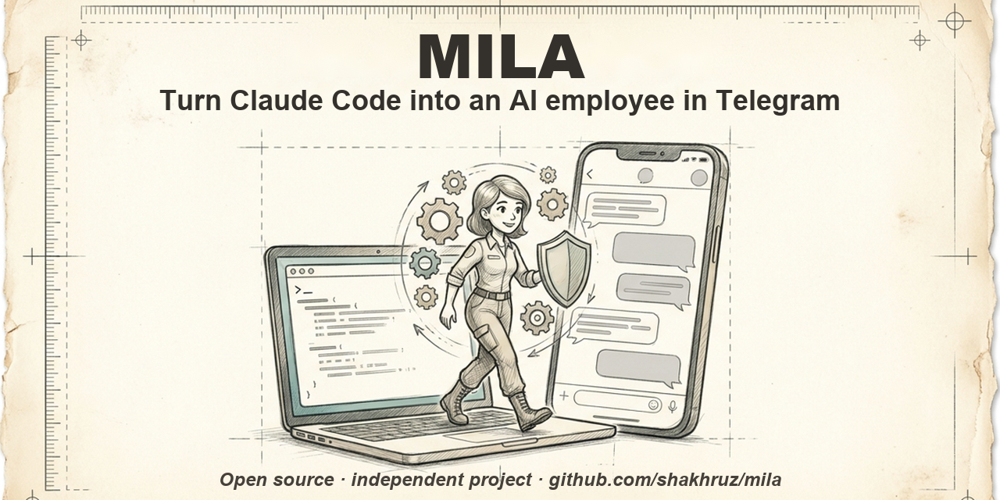

# Mila

**Open-source digital employee in Telegram. Runs on your Claude subscription, remembers your business, acts in your name only with your consent.**

*Warm by design.*

**English** · [中文](README.zh-CN.md) · [Русский](README.ru.md) · [Oʻzbekcha](README.uz.md)

[](https://github.com/shakhruz/mila/actions/workflows/tests.yml) [](https://github.com/shakhruz/mila/releases/latest) [](LICENSE)

Mila is part of something bigger — read our Manifesto: [milagpt.io/en/manifest](https://milagpt.io/en/manifest/)

- **Answers your customers in Telegram** — day and night, in their language.
- **Remembers your business** — every client, conversation and promise; one short summary for you every morning.
- **Acts on your behalf only with your yes** — every such action is in a journal; your files stay in your own home folder; conversations go only to the model providers you choose.

```sh
curl -fsSL https://raw.githubusercontent.com/shakhruz/mila/main/install/get.sh | bash
```
≈ 5 minutes. You need: Claude Code (with a Claude subscription), [Bun](https://bun.sh), a Telegram bot token from `@BotFather`. Details — [Quick start](#quick-start).



**Current release: [v1.5.2](https://github.com/shakhruz/mila/releases/latest)** · [what's new](CHANGELOG.md)

**Which version to take:** stable — [Releases](https://github.com/shakhruz/mila/releases) (tags `vX.Y.Z`); canary — the `main` branch (newest, may break).

### Claude — by Anthropic's rules

- Mila runs on the ordinary, unmodified Claude Code, installed as Anthropic publishes it.
- You sign in yourself, only on Anthropic's page, with your own Claude plan or your own Anthropic API key. Mila never copies or stores your login or token; don't copy an OAuth token anywhere yourself.
- Your plan is for your own use. Customers and guests who write to your bot are served through an API key, billed to the key's owner.
- A partner who sets Mila up for you does not run you on the partner's subscription, does not pay for, resell or intermediate your Claude usage, and does not collect logins.

Source: [Claude Code — legal and compliance](https://code.claude.com/docs/en/legal-and-compliance).

## Speaks your customer's language

3 out of the box — **English, Русский, Oʻzbek**; **中文 — new**, in testing — add yours in one file (the owner's greeting `skills/onboarding/GREETING.<code>.md`). Mila replies in the language the customer writes in, not the language of their phone settings.

```
Customer: Hi! Is the two-bedroom by the sea still free? Can I see it on Saturday?
Mila:     Hi! Yes, it's free 🙂 Saturday at 11:00 or 15:00 — which suits you? I'll book it and remind you an hour before.
Customer: 11, please.
Mila:     Done ✅ I'll send the address and remind you on Saturday morning.
```
In the morning the owner gets one line: *new client · viewing Saturday 11:00 · reminder set.*

Most open agents are universal: a powerful assistant that can do anything, if you tell it how.
Mila is built the other way round - as a colleague with a job. She answers your clients, keeps your promises,
remembers every conversation, writes the posts, reminds about meetings and tells you every morning what is
on fire. You talk to her from your phone, by text or voice, like to a person on your team.

- **A digital employee, not a universal agent.** Business skills out of the box: client chats, CRM of dialogs,
  promises and tasks, owner approval cards, weekly rhythm (plan in the morning, results in the evening),
  spending limits, mailings with your yes.
- **Telegram-native.** Your chats, your groups, your clients - Mila works where your business already talks.
  No new app to install.
- **One Mila, two wallets.** Your own Claude plan (or your own Anthropic API key) runs Mila for you, signed in by you; customers and guests are served pay-as-you-go through an API key via [OpenRouter](https://openrouter.ai), so the cost grows only with the customers Mila serves (guest routing: hosted version today, open core with the next mila-telegram release). Your files stay
  in your own home folder, conversations go only to the model providers you choose; Mila belongs to you 100% and moves with you (`mila export` / `mila restore`).
- **Safe by default.** Nothing goes out on your behalf without your yes; a send-guard blocks messages that would
  leak one conversation into another; spending above the limit needs your approval.
- **Open core, Apache-2.0.** Skills, hooks, tools and templates are here. Fork it, teach it, send a pull request.

Don't want to set it up yourself? Talk to [Mila Tashkent](https://t.me/mila_tashkent_bot): she will start your own
Mila in one conversation - 3 days for $5, then $50/month. Hosted version and the community: <https://milagpt.io/en/mila/>.
The Telegram plugin is a separate open repository: [shakhruz/mila-telegram](https://github.com/shakhruz/mila-telegram).

[Full reference](docs/REFERENCE.md)

## How Mila compares

OpenClaw, NanoClaw and Hermes Agent are excellent open agents - universal assistants for a person.
Mila takes a narrower job: a digital employee for a business, in Telegram.

| | **Mila** | OpenClaw | NanoClaw | Hermes Agent |
|---|---|---|---|---|
| What it is | digital employee for a business | universal personal agent | personal agent in containers | personal agent that grows with you |
| Engine | Claude Code | own agent loop, models as plugins | Claude Agent SDK | own agent loop, any model |
| Channels | Telegram: DMs, groups, your public bot | 20+ (WhatsApp, Telegram, Slack...) | many, each added by a skill | Telegram, Discord, Slack, WhatsApp... |
| Business skills out of the box | CRM of dialogs, promises and tasks, owner cards, weekly rhythm, mailings | general skills (ClawHub) | general skills | self-written skills |
| Nothing goes out without the owner's yes | yes, by design (constitution + send-guard) | exec approvals, Team preset | approval for credential use, self-modification and new chats; ordinary messages are not gated | approval for dangerous shell commands (fail-closed); no approval step for sending messages |
| Spending limits | yes (`spend` skill: forecast, approval above the limit) | no data | no data | per-employee limit (Business plan) |
| Your Mila moves with you | `mila export` / `mila restore` | Markdown memory files | per-group folders | own memory store |
| License | Apache-2.0 | MIT | MIT | MIT |
| Price | free to self-host; hosted from $50/month | free, self-host only | free; enterprise on request | free; Nous Portal $0-200/month |

**Mila's honest minuses.** Telegram only: no WhatsApp, Slack or Discord. It needs Claude Code, signed in with your own Claude plan
or API key — Mila herself runs only on Claude (guests can be served by other models through OpenRouter). macOS and Linux;
Windows only through WSL. Channels in Claude Code are a research preview, so the launcher uses a development flag for now
(see Quick start).

Facts about other projects: their READMEs and docs, checked 17.10.2026; approvals row re-checked 21.10.2026 against [NanoClaw security](https://docs.nanoclaw.dev/concepts/security) and [Hermes security](https://hermes-agent.nousresearch.com/docs/user-guide/security) -
[OpenClaw](https://github.com/openclaw/openclaw),
[NanoClaw](https://github.com/nanocoai/nanoclaw), [Hermes Agent](https://github.com/NousResearch/hermes-agent).
Something wrong or out of date? Open an issue - we fix it the same day.

## What is inside

| Path | What |
|---|---|
| `skills/` | The abilities: communication, tasks, CRM of dialogs, cards for the owner, group behaviour, mailings, spending control, flashcards, infographics, video/podcast overviews, updates. |
| `install/` | Installer, the `mila` launcher, hooks (inbox feed, reply-required), usage/limit tools, `doctor`, `backup`. |
| `templates/home/` | Hooks and settings for a Mila home directory: the send-guard hook, session-start hook. |
| `canon/` | Working principles (live today, reframe, weekly rhythm). |
| `deploy/` | Bootstrap script for a fresh Linux server. |
| `packs/webmaster/` | Optional: build and deploy a website by the companion itself. |
| `CONSTITUTION.md` | The values every Mila is read to first. |

## Quick start

≈ 5 minutes.

**You need:**
- macOS or Linux. On Windows — inside [WSL](https://learn.microsoft.com/windows/wsl/install).
- [Claude Code](https://code.claude.com/docs/en/setup), tested on 2.1.305 (`claude --version`), signed in with your own Claude plan (Pro, Max, Team or Enterprise) or your own Anthropic API key. On Team and Enterprise your organization admin must enable channels.
- [Bun](https://bun.sh) and git.
- A Telegram bot token from `@BotFather`.
- `~/.local/bin` on your `PATH` — the `mila` launcher goes there (the installer tells you if it is missing: `export PATH="$HOME/.local/bin:$PATH"`).
- Nothing else: your Telegram id is set by `mila onboard` (step 3). Setting it by hand: `MILA_OWNER_ID=<your id> ~/mila/install/install.sh`.

One command:

```sh
curl -fsSL https://raw.githubusercontent.com/shakhruz/mila/main/install/get.sh | bash
```

It checks Claude Code, Bun and git, clones the kit to `~/mila`, runs `install/install.sh` and installs the Telegram plugin `mila-telegram` (existing files are backed up as `<file>.bak-YYYYMMDD-HHMMSS`). Prefer to look first? `curl -fsSL https://raw.githubusercontent.com/shakhruz/mila/main/install/get.sh | MILA_INSTALL_ARGS=--dry-run bash` — or clone and run `./install/install.sh --dry-run`: it shows exactly what will be touched.

Then three steps, each checked before the next:

```sh
mila onboard
```

1. **Bot token** — paste it (hidden), Telegram confirms it, it is saved with mode 600.
2. **Claude** — if you are not signed in, Anthropic's own sign-in opens; Mila never sees it.
3. **Pair** — you get a 6-character code, send it to your bot from Telegram; you become the owner (allowlist + `OWNER_ID`).

Then start Mila with `mila`. `mila onboard --check` shows the three steps without changing anything; if the bot goes quiet, run
`mila doctor`. Prefer the plugin's own commands? `/mila-telegram:configure <token>` and `/mila-telegram:access pair <code>` still work.

**Why `mila` starts Claude Code with `--dangerously-load-development-channels`.** Channels are a research preview in
Claude Code: the plain `--channels` flag accepts only plugins on Anthropic's approved list, and `mila-telegram` is not on it
yet. The development flag lets this one plugin, named in the command, push messages into your session; it does not
skip permission prompts and does not load anything else. Messages still reach Mila only from people you paired or allowed.
If the plugin is accepted into Anthropic's plugin marketplace, `mila` will switch to plain `--channels`. Details:
[Claude Code — channels](https://code.claude.com/docs/en/channels#research-preview).

When it works, `mila doctor` looks like this (yellow lines are hints, not errors):

```
Channel diagnosis · ~/.claude/channels/telegram

🟢 bot                @your_mila_bot (Mila), source: ~/.claude/channels/telegram/.env
🟡 privacy mode       on — in groups only mentions and replies reach Mila
🟢 private chats      allowed 1, policy «allowlist»
🟢 daemon             running, code: …/mila-telegram/receiver.ts
🟢 permissions        telegram — 700, .env — 600, access.json — 600
🟢 channel in session plugin MCP server is running
```
Server install: see [deploy/README.md](deploy/README.md).

## Revive your Mila from an archive

A Mila belongs to her owner, 100%. Everything you taught her - instructions, skills, memory, crons, settings - exports to one
archive, and this open core plus that archive brings her back on any machine.

```sh
mila export --out ~/mila-backups     # archive without passwords and keys (a secret scanner runs on every file)
mila export verify <archive>         # manifest + sha256 check
# on a clean machine, after install/install.sh or deploy/bootstrap.sh:
mila restore <archive> --dry-run     # see what goes where
mila restore <archive>               # existing files are never overwritten; differences go to ~/.claude/mila-restore/
```

The archive has `manifest.json` (format 1, sha256 of each file, core version) and `RESTORE.md`; secrets are never in it.
After the restore you re-enter by hand: the bot token, your Claude login, service keys (the checklist is printed).
Chat history and transcripts are exported only with `--with-history` (other people's data - keep it closed).
Details: [skills/mila-export](skills/mila-export/SKILL.md). To save the memory on a schedule, use `mila backup` (see above in the reference).

## Safety

The send-guard hook blocks messages that would leak one conversation into another or expose server
paths; if the guard itself fails, nothing is sent. See [SECURITY.md](SECURITY.md).

## Who builds Mila

MILAGPT is a small team led by **Shakhruz Ashot Ashirov** - founder of MILAGPT and AshotAI, 40 years in software,
28 of them in commercial development and online marketing (Disney, Apple, AT&T), and **Farangiz Sharapova** -
co-founder of MILAGPT. A fleet of Milas works next to us every day: development, quality, content, clients -
this repository is the core they run on.

**Developers, join us.** Build a skill, fix a hook, translate a skill to your language, tell us what broke.
Every pull request is read by a person and by Mila Quality. Good contributors are invited to the core team.
Start with [CONTRIBUTING.md](CONTRIBUTING.md).

## Community

Questions, ideas, show what your Mila does: [GitHub Discussions](https://github.com/shakhruz/mila/discussions).
Bugs: [Issues](https://github.com/shakhruz/mila/issues). Security: [SECURITY.md](SECURITY.md).

## Contributing, license, name

[CONTRIBUTING.md](CONTRIBUTING.md) · code under [Apache-2.0](LICENSE) ([NOTICE](NOTICE)) ·
the names "Mila", "MILAGPT" and the logo are trademarks, see [TRADEMARKS.md](TRADEMARKS.md).

*Claude and Claude Code are trademarks of Anthropic, PBC. Mila is an independent open-source project, not affiliated with, endorsed or sponsored by Anthropic.*
